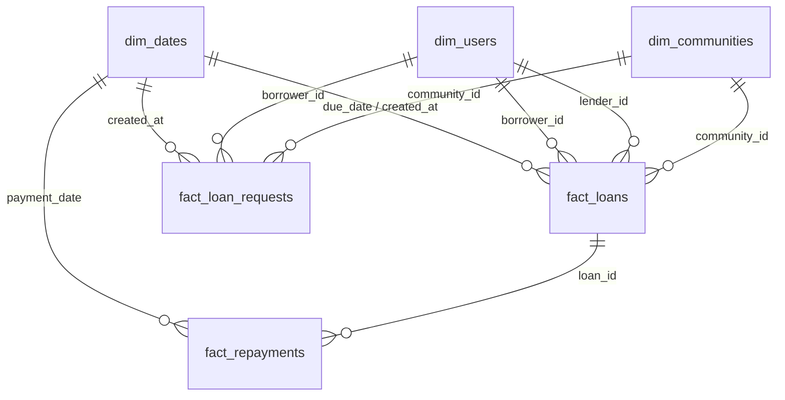

# MukoLend Power BI Reporting Architecture & Implementation Guide

## 1. Executive Summary

**MukoLend** is a peer-to-peer community lending management platform designed for Mukando groups and savings clubs across Zimbabwe. To empower community administrators, microfinance sponsors, and cooperative federations with executive-level business intelligence, MukoLend features an integrated Power BI export architecture.

This guide outlines the complete star-schema data model, dimensional relationships, DAX business measures, report page wireframes, and data validation checklists required to build and maintain production Power BI dashboards using MukoLend's CSV exports.

---

## 2. Source Data Architecture & CSV Export Pipeline

MukoLend exports all core transactional and dimension tables directly from `/analytics/export/<table_name>` as standard RFC 4180 CSV files. Financial amounts are converted from internal integer cents (minor units) to standard decimal currency units (e.g. `15000` cents $\rightarrow$ `150.00` USD) for seamless analytical ingestion.

### Exported File Specifications

| Export File Name | Source Table | Classification | Primary Key | Key Foreign Keys |
| :--- | :--- | :--- | :--- | :--- |
| `dim_users.csv` | `users` | Dimension | `user_id` | N/A |
| `dim_communities.csv` | `communities` | Dimension | `community_id` | `created_by` $\rightarrow$ `dim_users(user_id)` |
| `fact_loan_requests.csv` | `loan_requests` | Fact | `request_id` | `community_id`, `borrower_id` |
| `fact_loans.csv` | `loans` | Fact | `loan_id` | `request_id`, `borrower_id`, `lender_id`, `community_id` |
| `fact_repayments.csv` | `repayments` | Fact | `repayment_id` | `loan_id`, `recorded_by` |
| `fact_audit_log.csv` | `audit_log` | Fact (Audit) | `audit_id` | `user_id` |

---

## 3. Recommended Star Schema Data Model

In Power BI Desktop, structure the tables into an optimized Star Schema with a centralized Date Dimension:



### Table Relationships in Power BI Model View

1. **`dim_communities` to `fact_loans`**:
   - Cardinality: `1 to Many (1:*)`
   - Cross filter direction: `Single`
   - Active: `dim_communities[id] = fact_loans[community_id]`

2. **`dim_users` to `fact_loans` (Role-Playing Dimension)**:
   - Borrower Relationship (Active): `dim_users[id] = fact_loans[borrower_id]`
   - Lender Relationship (Inactive): `dim_users[id] = fact_loans[lender_id]` *(Use `USERELATIONSHIP` in DAX)*

3. **`dim_dates` to `fact_loans`**:
   - Loan Origination (Active): `dim_dates[Date] = fact_loans[created_date]`
   - Loan Maturity / Due Date (Inactive): `dim_dates[Date] = fact_loans[due_date]`

4. **`fact_loans` to `fact_repayments`**:
   - Cardinality: `1 to Many (1:*)`
   - Cross filter direction: `Single`
   - Active: `fact_loans[id] = fact_repayments[loan_id]`

---

## 4. Key Business Questions Answered

1. **Portfolio Health**: What is the total volume of community loans disbursed, and what proportion remains active vs repaid vs delinquent?
2. **Community Trust & Reliability**: Which Mukando circles achieve the highest on-time repayment performance?
3. **Lending Velocity**: How rapidly are loan requests accepted and funded by community peers?
4. **Delinquency Risk**: What is the portfolio-at-risk (PAR) past maturity, and which borrower cohorts require follow-up?
5. **Capital Efficiency**: What is the average simulated loan turnaround time from agreement acknowledgement to full settlement?

---

## 5. Standard DAX Measures Library

Add these core DAX measures to a dedicated `_Measures` table in Power BI:

### 1. Total Approved Loan Volume
```dax
Total Approved Volume = 
CALCULATE(
    SUM(fact_loans[principal_amount]),
    fact_loans[status] IN {"active", "repaid", "overdue"}
)
```

### 2. Total Simulated Repayment Volume
```dax
Total Repayment Volume = 
SUM(fact_repayments[amount])
```

### 3. Outstanding Portfolio Balance
```dax
Outstanding Balance = 
VAR TotalObligation = CALCULATE(
    SUM(fact_loans[total_due]),
    fact_loans[status] IN {"active", "overdue"}
)
VAR RepaymentsOnActive = CALCULATE(
    SUM(fact_repayments[amount]),
    fact_loans[status] IN {"active", "overdue"}
)
RETURN
TotalObligation - RepaymentsOnActive
```

### 4. Repayment Performance Rate (%)
```dax
Repayment Performance Rate = 
DIVIDE(
    [Total Repayment Volume],
    CALCULATE(SUM(fact_loans[total_due]), fact_loans[status] <> "cancelled"),
    0
)
```

### 5. Delinquency Rate (%)
```dax
Delinquency Rate = 
VAR OverduePrincipal = CALCULATE(
    SUM(fact_loans[principal_amount]),
    fact_loans[status] = "overdue"
)
VAR TotalActivePrincipal = CALCULATE(
    SUM(fact_loans[principal_amount]),
    fact_loans[status] IN {"active", "overdue"}
)
RETURN
DIVIDE(OverduePrincipal, TotalActivePrincipal, 0)
```

### 6. Average Loan Size
```dax
Average Loan Size = 
AVERAGEX(
    FILTER(fact_loans, fact_loans[status] <> "cancelled"),
    fact_loans[principal_amount]
)
```

### 7. Active Borrower Count
```dax
Active Borrowers = 
CALCULATE(
    DISTINCTCOUNT(fact_loans[borrower_id]),
    fact_loans[status] IN {"active", "overdue"}
)
```

### 8. Active Lender Count
```dax
Active Lenders = 
CALCULATE(
    DISTINCTCOUNT(fact_loans[lender_id]),
    fact_loans[status] IN {"active", "overdue"}
)
```

---

## 6. Recommended Report Page Wireframes

### Page 1: Executive Portfolio Summary
- **Top KPI Cards**: Total Approved Volume, Repayment Rate, Outstanding Balance, Active Peer Contracts, Overdue Rate.
- **Visual 1 (Area / Line Chart)**: Monthly Loan Origination vs Repayment Inflows.
- **Visual 2 (Donut Chart)**: Loan Status Distribution (`active`, `repaid`, `overdue`, `awaiting_agreement`).
- **Visual 3 (Table)**: Top 10 Active Peer Loans sorted by Outstanding Balance and Due Date urgency.

### Page 2: Mukando Community Performance
- **Visual 1 (Clustered Bar Chart)**: Total Capital Deployed by Community vs Total Repaid.
- **Visual 2 (Scatter Chart)**: Member Count vs Repayment Rate per Community Circle.
- **Visual 3 (Matrix)**: Community Name, Member Count, Loans Issued, Disbursed USD, Repaid USD, Performance Rate (Conditional color formatting from red to green).

### Page 3: Repayment Behavior & Velocity
- **Visual 1 (Histogram)**: Repayment Duration (Days from acknowledgement to final repayment).
- **Visual 2 (Line Chart)**: Cumulative Disbursed vs Cumulative Repaid over time.
- **Visual 3 (Table)**: Simulated Payment Voucher Ledger with reference codes, dates, and payer IDs.

### Page 4: Risk & Delinquency Tracking (PAR)
- **Top Alert KPI Cards**: Overdue Exposure ($), Delinquent Loans Count, Average Days Overdue.
- **Visual 1 (Aging Bar Chart)**: Delinquency Buckets (1–7 days overdue, 8–14 days, 15–30 days, 30+ days).
- **Visual 2 (Detail Table)**: Delinquent Loans with Borrower Name, Lender Name, Community, Due Date, Principal, and Contact Email.

---

## 7. Data Ingestion & Refresh Instructions

1. **Export Files**: Navigate to `/analytics` in the MukoLend web application and click each export button to download the latest CSV files into a local folder (e.g., `C:\MukoLend_BI_Data\`).
2. **Open Power BI Desktop**: Select **Get Data** $\rightarrow$ **Text/CSV** or **Folder**.
3. **Power Query Transformations**:
   - Ensure `id`, `user_id`, `borrower_id`, `lender_id`, `community_id` columns are formatted as `Whole Number` or `Text`.
   - Ensure `amount`, `principal_amount`, `fee`, `total_due` are formatted as `Fixed Decimal Number` (`Currency`).
   - Parse `created_at`, `due_date`, and `payment_date` as `Date/Time` or `Date`.
4. **Publish**: Publish the report to Power BI Service for community stakeholder access.

---

## 8. Data Validation Checklist

Before publishing reporting dashboards, verify these invariants against the MukoLend `/analytics` web dashboard:

- [ ] **Total Approved Volume**: Sum of `fact_loans[principal_amount]` matches `kpis.total_approved_principal_minor / 100` in MukoLend.
- [ ] **Total Repayments Collected**: Sum of `fact_repayments[amount]` exactly matches `kpis.total_repayments_minor / 100`.
- [ ] **Loan Count Balance**: Total rows where `status != 'cancelled'` equals `kpis.total_approved_loans_count`.
- [ ] **Zero Negative Balances**: No loan record in Power BI shows `Outstanding Balance < 0`.
- [ ] **Dual-Acknowledgement Check**: All loans with `status = 'active'` have both `borrower_accepted = 1` and `lender_accepted = 1`.
